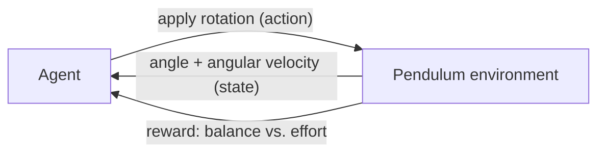

# Pendulum Balancer: Reinforcement Learning Agent

A reinforcement-learning agent that learns to balance a pendulum on its own. The agent rotates the pendulum, and through reward-based training it learns to reach a stable upright balance while keeping the force from its rotation under control. Built as a class project for my Reinforcement Learning Theory course at VIT-AP University.

[Portfolio](https://ameerroshan.me/) · [GitHub](https://github.com/Rosh-am)

---

## The Idea

A pendulum balanced upright is an unstable system: the slightest tilt makes it fall. The agent has no built-in rules for balancing. Instead it:

1. **Observes** the pendulum's state (angle and angular motion).
2. **Acts** by applying rotation (torque) to the pendulum.
3. **Receives a reward** that is higher the closer the pendulum is to perfect balance, and lower when it swings or when the applied force is excessive.
4. **Improves** its policy over many episodes until it balances reliably.

The goal is not just to reach the upright position but to hold it smoothly, keeping the rotational force in check.

## How It Works



| Component | Description |
|-----------|-------------|
| State | Pendulum angle and angular velocity |
| Action | Rotational force applied to the pendulum |
| Reward | Rewards staying balanced, penalizes swinging and excessive force |
| Learning | Reward-based training over repeated episodes |

> TODO: fill in the exact algorithm you used (for example Q-learning, DQN or policy gradient), the discretization or network details, and the hyperparameters.

## Results

> TODO: add a GIF or screenshot of the trained agent balancing, and a reward-per-episode plot if you have one (save them in an `assets/` folder and embed with ``).

## Tech Stack

| Area | Tools |
|------|-------|
| Language | Python |
| Domain | Reinforcement Learning, Simulation |

> TODO: list the libraries used (for example NumPy, Matplotlib, Gymnasium).

## Getting Started

```bash
# 1. Clone the repository
git clone https://github.com/Rosh-am/pendulum-balancer-rl.git
cd pendulum-balancer-rl

# 2. (Optional) create a virtual environment
python -m venv venv
source venv/bin/activate        # Windows: venv\Scripts\activate

# 3. Install dependencies
pip install -r requirements.txt

# 4. Train the agent
python train.py
```

> TODO: replace the file names and commands with the ones in your project.

## Repository Structure

```
pendulum-balancer-rl/
├── assets/           # Demo GIFs and plots
├── src/              # Environment and agent code
├── requirements.txt
└── README.md
```

> TODO: adjust to match your actual folders.

## Course Context

Reinforcement Learning Theory class project, VIT-AP University, 2025.

## Author

**Ameer Roshan SK** · [GitHub](https://github.com/Rosh-am) · [LinkedIn](https://www.linkedin.com/in/ameer-roshan-sk/) · [Portfolio](https://ameerroshan.me/)
